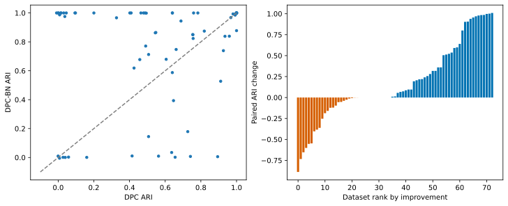
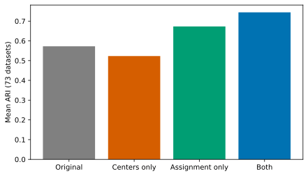

# DPC-BN

Density Peak Clustering with Minimax Path Distance.

DPC-BN selects local density peaks by farthest-first traversal under minimax path distance, then assigns observations by the same distance. Distances are computed exactly on a minimum spanning tree of the complete Euclidean graph.

## Installation

```bash
python -m pip install -r requirements.txt
```

## Run

The input MATLAB file must contain a numeric `data` matrix with one observation per row. The cluster count is supplied explicitly. Class labels are not read by the algorithm.

```bash
python dpc_bn.py jain.mat --clusters 2 --output results/jain.npz
```

Use `--transpose` if observations are columns. Defaults are `--percentile 2` and `--neighbors 5`.

```python
from dpc_bn import fit
result = fit(samples, clusters=2)
labels = result['labels']
centers = result['centers']
```

## Seven steps

1. Standardize features and compute Euclidean distances.
2. Estimate Gaussian density with a pairwise-distance percentile bandwidth.
3. Identify local density peaks.
4. Build a minimum spanning tree, preserving zero-weight edges.
5. Choose the highest-density point, then farthest-first centers among local peaks.
6. Assign observations by minimax path distance, breaking ties by Euclidean distance and center order.
7. Return labels, centers, peaks, density, bandwidth, fallback count, and cluster sizes.

The functions `step1_distances` through `step7_result` correspond to these steps. Indices start at zero. Density ties use input order. If peaks are exhausted, center selection continues among remaining observations.

## Scope

The number of clusters is a required hyperparameter, not automatically estimated. This dense implementation uses quadratic memory and is intended for small to medium datasets. Short-edge bridges between groups can cause clustering failures. Python with the GIL enabled or disabled can run the code; no free-threading speedup is claimed.

Dataset files and the manuscript text are not included.

## Figures from the manuscript

### Overall comparison



Primary results on 73 distinct synthetic datasets, excluding Jain and exact duplicates. Both algorithms use supplied cluster counts and the same Gaussian density. Left: paired ARI scores. Right: ARI differences, including gains and losses, sorted by improvement.

### Component ablation



Mean ARI across the same 73 datasets: original DPC 0.5727; center selection only 0.5231; assignment only 0.6732; both changes (DPC-BN) 0.7444. Density and supplied cluster counts remain fixed.

Both figures are provided in scalable SVG format.


## Benchmark

See [benchmark/README.md](benchmark/README.md) for the synthetic dataset manifest, four-way ablation runner, archived reference metrics, and aggregate plotting scripts. Verify input hashes before reproducing the 73-dataset comparison.

## License

This project is licensed under the [MIT License](LICENSE).

Copyright (c) 2026 Wu Heng.
